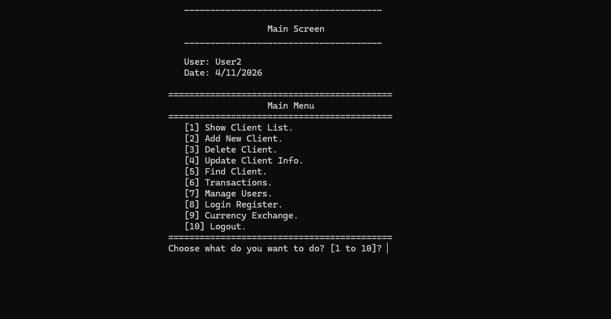
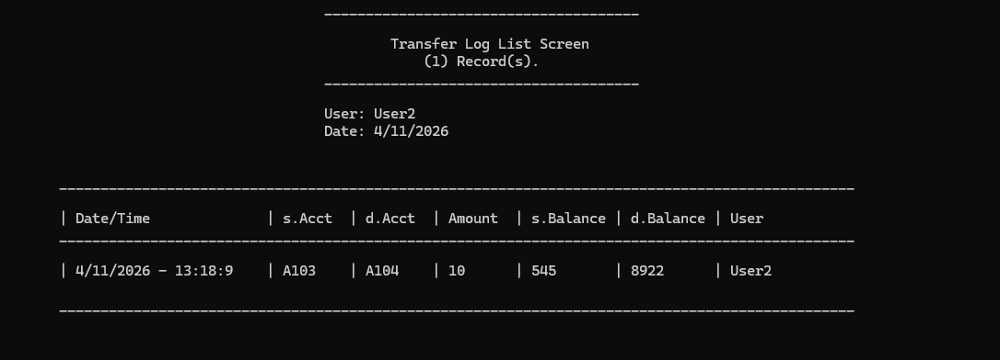
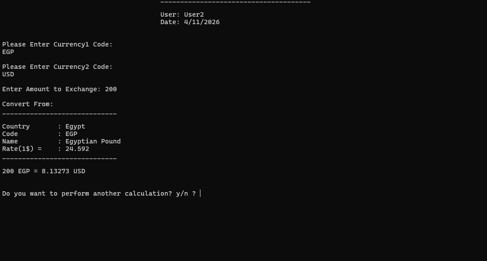
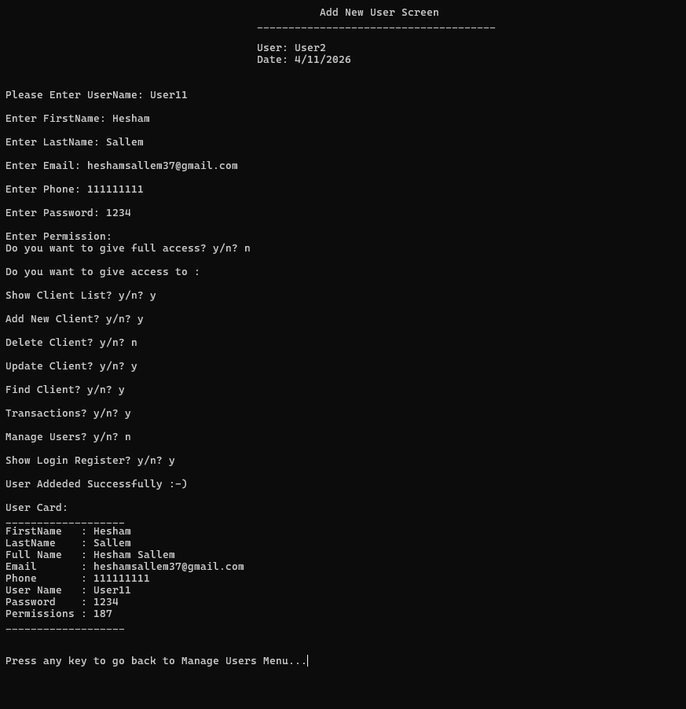

# Bank Management System (OOP)

A console-based Bank Management System developed in C++ using Object-Oriented Programming.

This was my sixth C++ project and my second project focused on OOP. It is an object-oriented rebuild of my earlier procedural Bank Management System, using classes, inheritance, encapsulation, and a reusable screen-based architecture, with text files (`.txt`) for data storage.
This is also my largest C++ project to date.

The application allows users to log in, manage clients and system users, perform banking transactions, transfer money between accounts, and work with currency exchange rates. All data is stored in text files, so it persists between application sessions.

## Features

- User login and authentication
  - Locks the login screen after 3 failed attempts
  - Login register that records every successful login
- Client management:
  - List all clients
  - Add new clients
  - Delete client records
  - Update client information
  - Search for clients by account number
- Banking transactions:
  - Deposit funds
  - Withdraw funds
  - Calculate total client balances
  - Transfer funds between two client accounts
  - Transfer log recording every transfer
- Currency exchange:
  - List all currencies
  - Find a currency by code or country
  - Update a currency's exchange rate
  - Currency calculator to convert amounts between currencies
- User management:
  - List users
  - Add new users
  - Delete users
  - Update user information
  - Search for users by username
- Customizable user permissions
- Full-access option for administrators
- Permission checks for restricted screens ("Access Denied" message)
- Persistent data storage using `.txt` files
- Console-based menu navigation

## Screenshots

### Main Menu



### Transactions



### Currency Exchange



### User Management



## Technologies

- **C++**
- Standard Library
  - `iostream`
  - `fstream`
  - `string`
  - `vector`
  - `iomanip`

## Concepts Demonstrated

This project was developed to practice C++ and OOP concepts, including:

- Classes and objects
- Encapsulation with private data members and public properties
- Inheritance (`clsPerson` as the base class for `clsBankClient` and `clsUser`)
- Abstract classes and pure virtual functions (`InterfaceCommunication`)
- A reusable base screen class (`clsScreen`) shared by all UI screens
- Static methods and utility classes (`clsString`, `clsDate`, `clsUtil`, `clsInputValidate`)
- Enumerations (`enum`) for menus, modes, and permissions
- Constructors and object modes (empty, add new, update)
- File handling and persistent storage
- String parsing and record serialization/deserialization
- CRUD operations (Create, Read, Update, Delete)
- Bitwise operations for permission management
- User authentication and access control
- Simple text encryption for stored passwords
- Header-based project organization (one class per `.h` file)

## Project Structure

| File | Purpose |
|------|---------|
| `Simple-Bank-App-CPP-OOP.cpp` | Program entry point |
| `InterfaceCommunication.h` | Abstract interface (`SendEmail`, `SendFax`, `SendSMS`) |
| `clsPerson.h` | Base class holding shared personal data |
| `clsBankClient.h` | Client data, deposits, withdrawals, transfers, and transfer log |
| `clsUser.h` | User data, permissions, and login register |
| `clsCurrency.h` | Currency data, rates, and conversion |
| `clsScreen.h` | Base class for screens (header drawing and access checks) |
| `cls*Screen.h` | Individual screens for each menu and operation |
| `clsString.h`, `clsDate.h`, `clsUtil.h`, `clsInputValidate.h` | Utility and input validation classes |
| `Global.h` | Holds the currently logged-in user |

## Data Storage

The application uses text files to store its data:

- `Clients.txt` — stores client names, email, phone, account numbers, PIN codes, and account balances.
- `Users.txt` — stores user details, usernames, encrypted passwords, and permission values.
- `Currencies.txt` — stores countries, currency codes, currency names, and exchange rates against the US dollar.
- `LoginRegister.txt` — created automatically to record login history.
- `TransfersLog.txt` — created automatically to record transfers between clients.

Each record is converted into a delimited text line using `#//#` as the field separator.

The application loads records from these files when needed and writes changes back to them, allowing data to persist between sessions.

## How It Works

1. The application displays a login screen.
2. The user enters a username and password (3 failed attempts lock the screen).
3. After successful authentication, the login is recorded and the main menu is displayed.
4. The user can manage clients, perform transactions, manage users, view the login register, or use currency exchange, depending on their permissions.
5. Deposits, withdrawals, and transfers update client balances and are saved to the text files.
6. Currency rates can be updated and used by the currency calculator.
7. Users can log out and return to the login screen.

## How to Run

### Requirements

- Windows operating system
- Visual Studio with C++ development tools installed

### Using Visual Studio

1. Clone the repository:

```bash
git clone https://github.com/HeshamSallem510/Bank-Management-System-CPP-OOP.git
```

2. Open the solution in Visual Studio.
3. Build the solution.
4. Run the application.
5. Use "User2" as the username to log in, 1234 for the password. You can use "User1" with the same password to try a user without permissions.

> The current implementation uses Windows-specific features, including `system("cls")`, `system("pause>0")`, and `__declspec(property)`, so it is intended for Windows with the Visual Studio (MSVC) compiler.

> The repository includes `Clients.txt`, `Users.txt`, and `Currencies.txt` with sample data to make it easier to run and explore the application. Make sure these files are in the same folder the program runs from.

> Please note that the passwords in the `Users.txt` are the passwords after the encryption. Most of the users in the file come with the password "1234". As the encryption key is 2, you will find them as "3456".

## Author

**Hesham Elsayed**

GitHub: [HeshamSallem510](https://github.com/HeshamSallem510)